# MovieMatch: Personalized Movie Recommendation Using User History

**ES 335 project report**

Solanki Viraj (24110348) · Individual Project

Repository: https://github.com/Viraj-Solanki/ES-335-Project · Website: https://viraj-solanki.github.io/ES-335-Project/

*All numbers in this report are generated from `outputs/metrics.json` by `python -m src.make_report`.*

---

## Abstract

We predict whether a MovieLens 100K user will rate a candidate movie 4–5 stars ("positive") from the user's earlier ratings and the movie's genres, and test whether this personalised prediction beats a non-personalised popularity baseline. With a leakage-safe chronological 80/10/10 split, Logistic Regression reaches a test PR-AUC of 0.746 against 0.743 for popularity and 0.563 for the majority baseline. The difference from popularity is not statistically distinguishable (user-level bootstrap 95% CI [-0.012, +0.017]). The main reason is cold start: under the guide's fixed-snapshot protocol, 85.8% of test rows come from users with no training-period ratings. When earlier ratings are allowed to inform later predictions (the guide's optional sequential protocol), Logistic Regression improves PR-AUC over popularity by +0.031 (95% CI [+0.010, +0.050]), and an ablation confirms the gain comes from the user-history features.

## 1. Problem formulation

| Item | Definition |
|---|---|
| Research question | Can a user's previous ratings and movie information predict whether the user will positively rate a candidate movie? Does personalisation improve on a popularity baseline? |
| One row | One user–movie interaction (a user rated a movie at a time). |
| Target | 1 if rating ≥ 4; 0 if rating ≤ 3. Fixed before modelling. |
| Prediction time | When a recommendation is generated, before the user rates the candidate. |
| Inputs | The user's earlier ratings, the candidate's genres and release year, movie statistics from the training period. |
| Output | A probability per user–movie pair and a ranked list of candidates. |

A 1–3 rating is "not positive" for this experiment, not proof of dislike. Unrated movies are unknown and are never used as negatives.

## 2. Data

MovieLens 100K (GroupLens Research). The archive's MD5 matched the published checksum (`0e33842e24a9c977be4e0107933c0723`) and the counts match the README: 100,000 ratings, 943 users, 1,682 movies, from 1997-09-20 to 1998-04-22. `u.item` is pipe-separated and Latin-1 encoded although the README says tab-separated. Demographic data in `u.user` was not used.

**Quality checks.** Missing rating values: 0. Duplicate user–movie pairs: 0. Ratings outside 1–5: 0. Unmatched movie IDs after the join: 0. Movies without release date: 1 (imputed with the training median inside the model pipeline). Movies flagged genre "unknown": 2. Duplicate titles under different IDs: 18 (kept as separate items).

**Summary.** Positive rate 55.4%. Ratings per user: min 20, median 65, max 737. Ratings per movie: min 1, median 27, max 583; 333 movies have fewer than 5 ratings and the top 10% of movies hold 43% of all ratings. Matrix sparsity 93.7%.

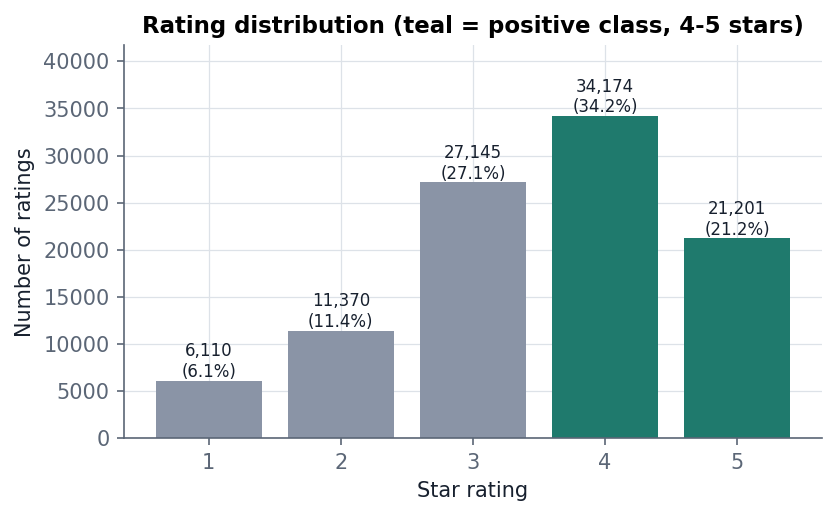
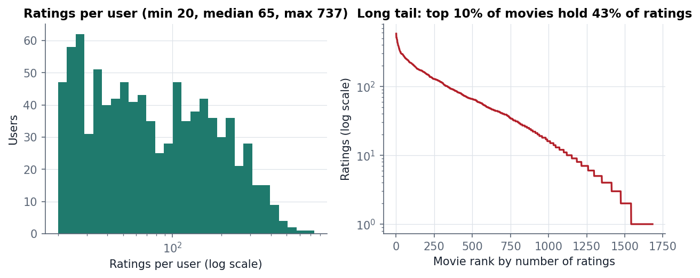
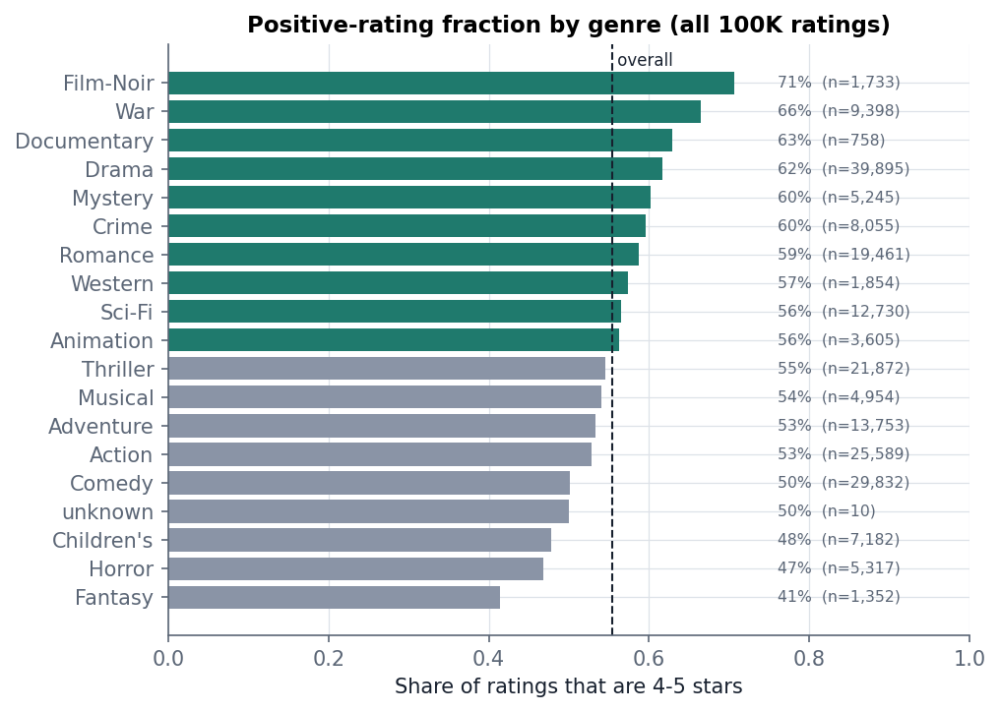

## 3. Preprocessing and split

1. Load files with README column names; join ratings to movies.
2. Quality checks (above).
3. Create the binary target.
4. **Chronological split before any feature is computed.** Ratings are sorted by timestamp and cut at timestamps (not row positions), so no training rating is later than any validation rating.
5. Build features (Section 4).
6. Fit imputer, scaler and model inside a scikit-learn `Pipeline` on training rows only.

| Split | Rows | First (UTC) | Last (UTC) | Users | Movies | Positive rate |
|---|---:|---|---|---:|---:|---:|
| Train | 79,999 | 1997-09-20 03:05:10 | 1998-03-07 02:20:47 | 751 | 1,616 | 55.1% |
| Validation | 10,001 | 1998-03-07 02:21:09 | 1998-03-31 22:11:07 | 197 | 1,200 | 56.7% |
| Test | 10,000 | 1998-03-31 22:11:49 | 1998-04-22 23:10:38 | 166 | 1,343 | 56.3% |

Validation starts at Unix time 889237269 (1998-03-07 02:21:09+00:00); test starts at 891382309 (1998-03-31 22:11:49+00:00). SHA-256 fingerprint of the split assignment (printed by `src.run_pipeline`): `5c82227b4259f25598c390b74bc74cb8edbd9d137bbeee8cc531b73555df887d`.

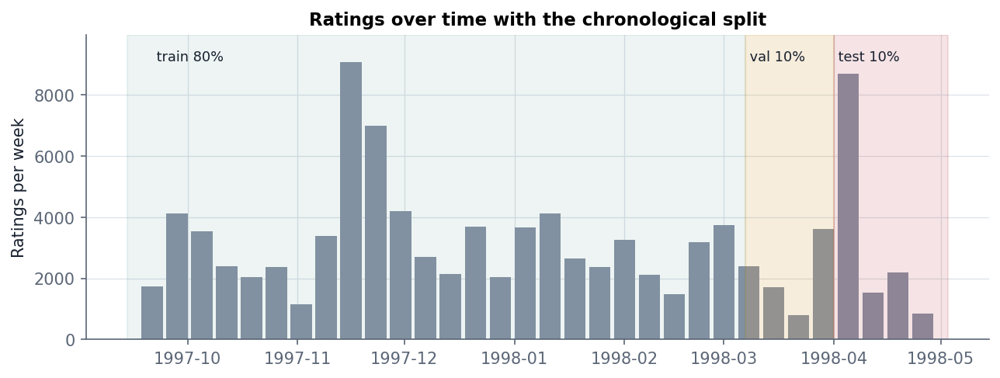

## 4. Features and leakage prevention

| Feature | Construction |
|---|---|
| `user_hist_count_log`, `user_is_cold` | log(1 + number of the user's earlier ratings); flag when zero. |
| `user_mean_rating`, `user_pos_rate` | From earlier ratings only, shrunk toward the training-period global value with 5 pseudo-ratings. |
| `user_genre_affinity` | For each candidate genre, the user's earlier positive rate in that genre (shrunk toward the user's overall rate, 3 pseudo-ratings), averaged over the candidate's genres. |
| `user_genre_affinity_rel`, `user_genre_share` | Affinity minus the user's base rate; share of the user's history in the candidate's genres. |
| `movie_mean_rating`, `movie_pos_rate`, `movie_hist_count_log`, `movie_is_cold` | Candidate's training-period ratings only, shrunk with 10 pseudo-ratings. |
| `genre_*` (19), `release_year` | Candidate metadata from `u.item`. |

Global priors (from training only): positive rate 0.5509, mean rating 3.5177.

**How leakage is prevented.**

* *Training rows* use an expanding history: only ratings with a **strictly earlier timestamp**. The row's own rating and any rating in the same second are excluded.
* *Validation and test rows* (primary protocol) use a snapshot of the training period frozen at the cutoff. No validation or test rating ever enters a feature.
* Smoothing priors and the release-year imputation value come from training data only.
* Hyperparameters and thresholds use validation data only. All design choices were fixed before the test split was first scored, and later re-runs (to add exports) produced identical metrics.
* `tests/test_leakage.py` recomputes features for 300 random training rows and 300 random validation/test rows with slow explicit loops and checks they equal the vectorised features. All tests pass.

**Cold start.** Under the fixed snapshot, 84.7% of validation rows and 85.8% of test rows belong to users with no training ratings (97 of 166 test users). Users in this dataset tend to join, rate many movies in one burst and leave, so most later users are new. Fallback: smoothed features collapse to the training-wide priors and the cold-start flag is set.

**Secondary protocol (sequential simulation).** Following the guide's optional design, every rating made before the prediction time *t* is treated as observable and nothing at or after *t* is. Only 1.7% of test rows then lack user history. The *same* models trained on the training split are used; only thresholds are re-chosen on sequential validation data. Training rows have identical features under both protocols.

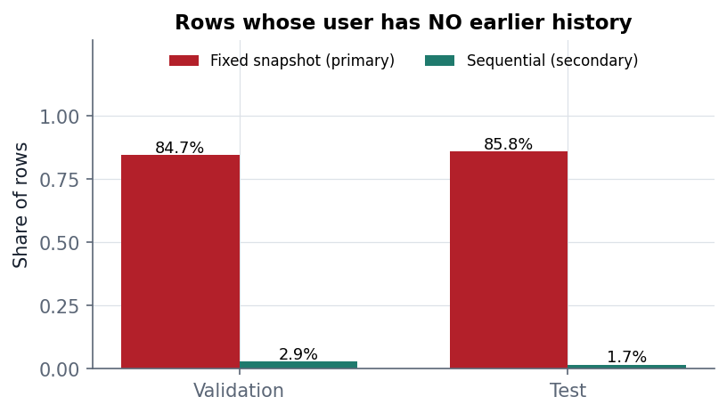

## 5. Methods

* **Majority baseline**: predicts the majority training class (positive) for every pair.
* **Popularity baseline**: score = the movie's smoothed training-period positive fraction; the same ordering for every user.
* **Logistic Regression** (primary model): median imputation → standardisation → L2 logistic regression. C ∈ {0.001, 0.01, 0.1, 1, 10}; chosen C = 0.001.
* **Random Forest**: 300 trees, `max_features="sqrt"`, minimum leaf ∈ {5, 20, 50, 100}; chosen 100.
* **LR, movie features only** (ablation): Logistic Regression with every user feature removed.

Tuning criterion: validation PR-AUC. Classification threshold: the value maximising validation F1. Validation PR-AUC was nearly flat across C (0.001: 0.726, 0.01: 0.7254, 0.1: 0.7252, 1.0: 0.7252, 10.0: 0.7252), so the choice of C at the edge of the grid has little effect. Random Forest validation PR-AUC: leaf 5: 0.7175, leaf 20: 0.7244, leaf 50: 0.7253, leaf 100: 0.7256. Logistic Regression had the higher validation PR-AUC and is the selected model.

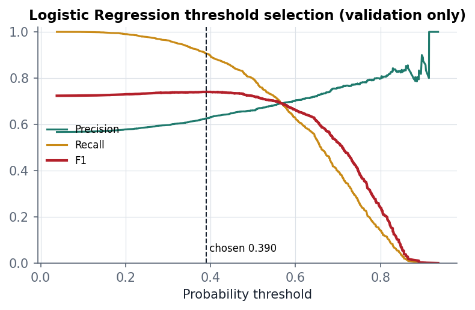

## 6. Results

### 6.1 Validation (fixed snapshot)

| Model | Threshold | Accuracy | Precision | Recall | F1 | PR-AUC | ROC-AUC |
|---|---:|---:|---:|---:|---:|---:|---:|
| Majority baseline | 0.500 | 0.5673 | 0.5673 | 1.0000 | 0.7240 | 0.5673 | 0.5000 |
| Popularity baseline | 0.396 | 0.6299 | 0.6157 | 0.9251 | 0.7393 | 0.7207 | 0.6886 |
| Logistic Regression | 0.390 | 0.6402 | 0.6264 | 0.9066 | 0.7409 | 0.7260 | 0.6938 |
| Random Forest | 0.397 | 0.6453 | 0.6332 | 0.8913 | 0.7404 | 0.7256 | 0.6942 |
| LR (movie features only) | 0.389 | 0.6454 | 0.6323 | 0.8964 | 0.7415 | 0.7225 | 0.6911 |

### 6.2 Test, fixed snapshot (primary result)

| Model | Threshold | Accuracy | Precision | Recall | F1 | PR-AUC | ROC-AUC |
|---|---:|---:|---:|---:|---:|---:|---:|
| Majority baseline | 0.500 | 0.5629 | 0.5629 | 1.0000 | 0.7203 | 0.5629 | 0.5000 |
| Popularity baseline | 0.396 | 0.6337 | 0.6185 | 0.9117 | 0.7370 | 0.7425 | 0.7049 |
| Logistic Regression | 0.390 | 0.6341 | 0.6226 | 0.8888 | 0.7322 | 0.7462 | 0.7043 |
| Random Forest | 0.397 | 0.6385 | 0.6293 | 0.8708 | 0.7306 | 0.7403 | 0.7005 |
| LR (movie features only) | 0.389 | 0.6448 | 0.6334 | 0.8760 | 0.7352 | 0.7462 | 0.7086 |

| Model | TN | FP | FN | TP |
|---|---:|---:|---:|---:|
| Majority baseline | 0 | 4,371 | 0 | 5,629 |
| Popularity baseline | 1,205 | 3,166 | 497 | 5,132 |
| Logistic Regression | 1,338 | 3,033 | 626 | 5,003 |
| Random Forest | 1,483 | 2,888 | 727 | 4,902 |

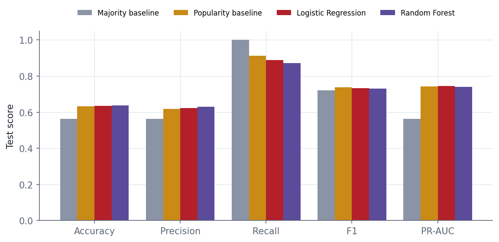
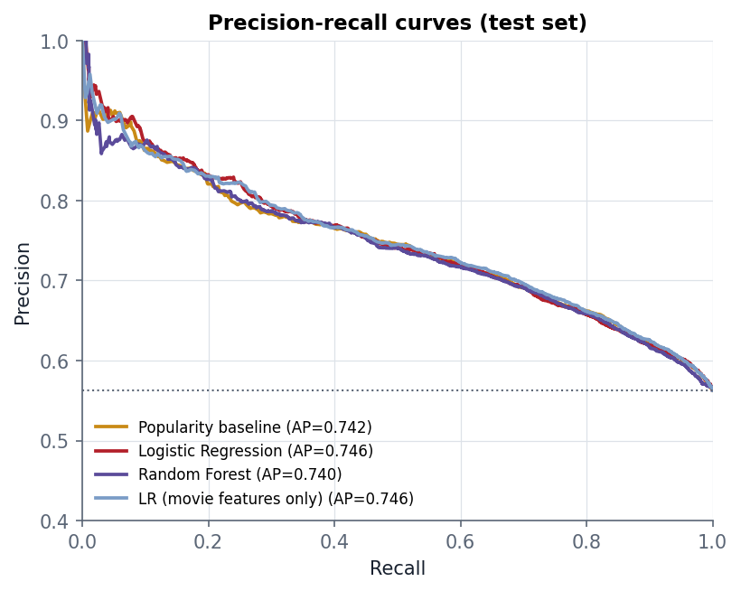
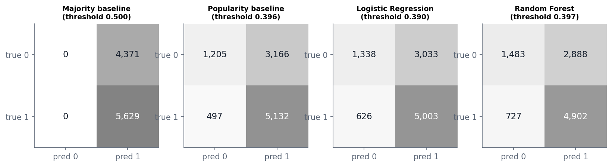

### 6.3 Test, sequential protocol (secondary)

| Model | Threshold | Accuracy | Precision | Recall | F1 | PR-AUC | ROC-AUC |
|---|---:|---:|---:|---:|---:|---:|---:|
| Majority baseline | 0.500 | 0.5629 | 0.5629 | 1.0000 | 0.7203 | 0.5629 | 0.5000 |
| Popularity baseline | 0.424 | 0.6456 | 0.6347 | 0.8728 | 0.7349 | 0.7449 | 0.7071 |
| Logistic Regression | 0.374 | 0.6805 | 0.6613 | 0.8865 | 0.7575 | 0.7755 | 0.7477 |
| Random Forest | 0.403 | 0.6826 | 0.6670 | 0.8708 | 0.7554 | 0.7772 | 0.7482 |
| LR (movie features only) | 0.390 | 0.6468 | 0.6355 | 0.8735 | 0.7357 | 0.7481 | 0.7101 |

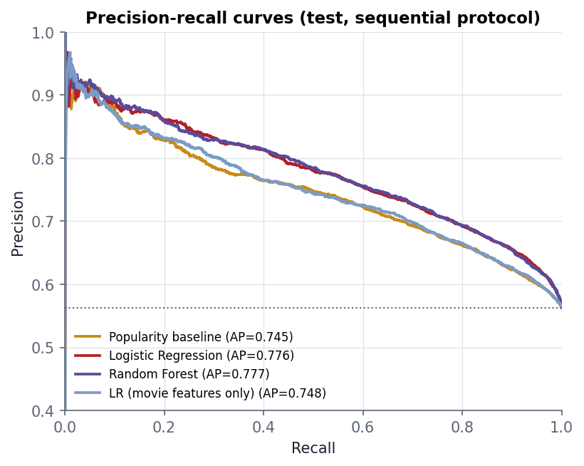

### 6.4 Uncertainty

Paired cluster bootstrap on the test set: users are resampled with replacement 1,000 times and PR-AUC differences recomputed from fixed predictions.

| PR-AUC difference | Fixed snapshot | 95% CI | Sequential | 95% CI |
|---|---:|---|---:|---|
| LR - Popularity | +0.004 | [-0.012, +0.017] | +0.031 | [+0.010, +0.050] |
| LR - LR(movie only) | +0.000 | [-0.015, +0.013] | +0.028 | [+0.007, +0.046] |
| RF - LR | -0.006 | [-0.012, +0.000] | +0.002 | [-0.002, +0.005] |

### 6.5 Results by amount of user history

Fixed snapshot:

| User history | Rows | Positive rate | Popularity PR-AUC | LR PR-AUC | RF PR-AUC | Popularity F1 | LR F1 | RF F1 |
|---|---:|---:|---:|---:|---:|---:|---:|---:|
| 0 (cold start) | 8,582 | 55.9% | 0.738 | 0.741 | 0.735 | 0.734 | 0.732 | 0.731 |
| 1-49 | 162 | 51.8% | 0.689 | 0.711 | 0.704 | 0.689 | 0.656 | 0.656 |
| 50-199 | 783 | 53.5% | 0.794 | 0.795 | 0.783 | 0.751 | 0.745 | 0.733 |
| 200+ | 473 | 69.6% | 0.803 | 0.901 | 0.903 | 0.783 | 0.747 | 0.734 |

Sequential:

| User history | Rows | Positive rate | Popularity PR-AUC | LR PR-AUC | RF PR-AUC | Popularity F1 | LR F1 | RF F1 |
|---|---:|---:|---:|---:|---:|---:|---:|---:|
| 0 (cold start) | 172 | 58.7% | 0.682 | 0.656 | 0.653 | 0.738 | 0.740 | 0.738 |
| 1-49 | 3,133 | 60.4% | 0.764 | 0.763 | 0.765 | 0.754 | 0.764 | 0.760 |
| 50-199 | 4,533 | 56.7% | 0.748 | 0.796 | 0.794 | 0.748 | 0.763 | 0.765 |
| 200+ | 2,162 | 49.3% | 0.708 | 0.791 | 0.789 | 0.668 | 0.733 | 0.721 |

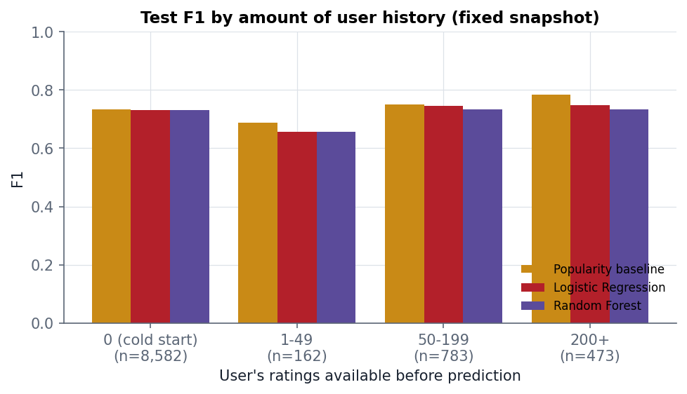
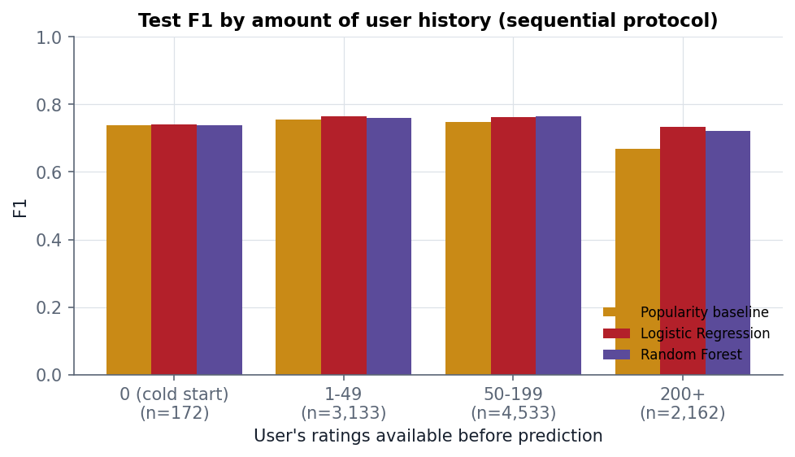

On the 1,418 fixed-snapshot test rows whose user has any training history, PR-AUC is 0.777 for full LR, 0.794 for movie-only LR and 0.785 for popularity.

### 6.6 Ranking within each user

For the 113 test users with at least 10 test ratings, each user's rated test movies are ranked by score.

| Method | P@5 fixed | P@10 fixed | Mean user AP fixed | P@5 sequential | P@10 sequential | Mean user AP sequential |
|---|---:|---:|---:|---:|---:|---:|
| Random order (expected) | 0.571 | 0.571 | n/a | 0.571 | 0.571 | n/a |
| Popularity baseline | 0.793 | 0.757 | 0.751 | 0.788 | 0.757 | 0.756 |
| Logistic Regression | 0.793 | 0.751 | 0.756 | 0.761 | 0.742 | 0.742 |
| Random Forest | 0.772 | 0.743 | 0.755 | 0.747 | 0.742 | 0.741 |

### 6.7 Model interpretation

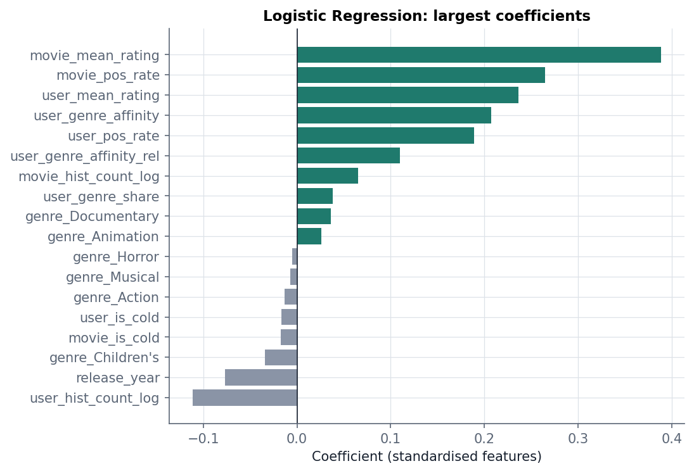
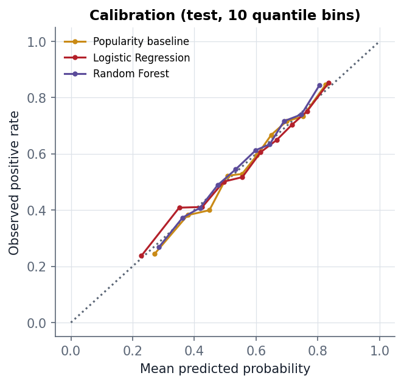

Largest standardised LR coefficients: `movie_mean_rating` +0.389, `movie_pos_rate` +0.265, `user_mean_rating` +0.236, `user_genre_affinity` +0.207, `user_pos_rate` +0.189, `user_hist_count_log` -0.112. Movie quality dominates, followed by the user's general rating tendency and genre affinity. Features are correlated, so coefficients indicate rough importance, not causal effects. All three scorers are well calibrated on the test set. Mean LR score by true rating: 1★ 0.409, 2★ 0.453, 3★ 0.523, 4★ 0.599, 5★ 0.651 — monotone, as expected.

### 6.8 Leakage demonstration (validation only)

A Logistic Regression trained on naive features that include each training row's own rating scores training PR-AUC 0.855 but validation PR-AUC 0.699, worse than the correct pipeline (0.774 train, 0.726 validation). Leakage inflates development results and harms real performance.

### 6.9 Sensitivity: excluding 3-star ratings

Dropping all 3-star ratings (task: 1–2 vs 4–5; rows train 58,235, validation 7,298, test 7,322; same timestamp boundaries):

| Model | F1 | PR-AUC | Positive rate |
|---|---:|---:|---:|
| Majority baseline | 0.8693 | 0.7688 | 76.9% |
| Popularity baseline | 0.8778 | 0.9108 | 76.9% |
| Logistic Regression | 0.8795 | 0.9138 | 76.9% |

The task becomes easier for every method; the ordering of methods is unchanged.

## 7. Error analysis

At the validation-chosen threshold (0.390), Logistic Regression makes 3,033 false positives and 626 false negatives on the test set. 67% of false positives are 3-star ratings (mean rating 2.58), and 90% come from cold-start users. 66% of false negatives are 4-star ratings. The F1-optimal threshold is low because the positive class is the majority, so the model leans toward predicting positive.

**Most confident false positives** (predicted positive, rated 1–3):

| User | Movie | Rating | LR score | User's earlier ratings | Movie positive rate | Movie's training ratings |
|---:|---|---:|---:|---:|---:|---:|
| 58 | It's a Wonderful Life (1946) | 2 | 0.886 | 126 | 0.75 | 179 |
| 125 | Manchurian Candidate, The (1962) | 3 | 0.879 | 80 | 0.85 | 93 |
| 125 | Dr. Strangelove or: How I Learned to Stop Worrying and Love the Bomb (1963) | 3 | 0.876 | 80 | 0.78 | 154 |
| 94 | Six Degrees of Separation (1993) | 3 | 0.868 | 82 | 0.69 | 56 |
| 911 | Casablanca (1942) | 3 | 0.890 | 0 (cold start) | 0.88 | 186 |
| 669 | Casablanca (1942) | 3 | 0.890 | 0 (cold start) | 0.88 | 186 |
| 807 | Close Shave, A (1995) | 3 | 0.864 | 0 (cold start) | 0.87 | 94 |

**Most confident false negatives** (predicted not positive, rated 4–5):

| User | Movie | Rating | LR score | User's earlier ratings | Movie positive rate | Movie's training ratings |
|---:|---|---:|---:|---:|---:|---:|
| 416 | Tales from the Hood (1995) | 4 | 0.072 | 279 | 0.20 | 23 |
| 186 | Beautician and the Beast, The (1997) | 4 | 0.101 | 67 | 0.20 | 73 |
| 708 | Free Willy 3: The Rescue (1997) | 4 | 0.104 | 44 | 0.22 | 24 |
| 655 | Love and Death on Long Island (1997) | 4 | 0.116 | 601 | 0.55 | 0 |
| 381 | Island of Dr. Moreau, The (1996) | 4 | 0.144 | 0 (cold start) | 0.15 | 48 |
| 489 | Mortal Kombat: Annihilation (1997) | 5 | 0.154 | 0 (cold start) | 0.24 | 34 |
| 807 | Speed 2: Cruise Control (1997) | 4 | 0.156 | 0 (cold start) | 0.18 | 31 |

Possible explanations (evidence, not proof): *popularity pull* — acclaimed classics such as *Casablanca* score high for every cold-start user, so a user who gives them 3 stars becomes a false positive; *minority tastes* — movies with a low positive rate (e.g. *Speed 2*, *Mortal Kombat: Annihilation*) get low scores, so users who enjoyed them are missed; *unusual profiles* — user 655 has 601 earlier ratings but a very low positive rate and rated a movie with no training ratings, so every signal pointed down.

| Genre | Test ratings | LR error rate | FP share | FN share |
|---|---:|---:|---:|---:|
| Action | 2,469 | 39.4% | 29.7% | 9.6% |
| Romance | 1,983 | 39.2% | 34.5% | 4.7% |
| Horror | 515 | 39.0% | 29.9% | 9.1% |
| Adventure | 1,278 | 38.3% | 29.4% | 8.8% |
| Musical | 502 | 37.5% | 29.7% | 7.8% |
| Comedy | 2,934 | 37.2% | 30.9% | 6.3% |
| Thriller | 2,224 | 37.1% | 28.9% | 8.2% |
| Crime | 822 | 36.7% | 33.1% | 3.6% |
| Sci-Fi | 1,203 | 36.5% | 29.1% | 7.4% |
| Western | 177 | 36.2% | 31.6% | 4.5% |
| Mystery | 646 | 35.0% | 30.5% | 4.5% |
| Drama | 4,124 | 34.8% | 31.1% | 3.7% |
| Children's | 694 | 34.6% | 25.1% | 9.5% |
| Animation | 319 | 33.2% | 27.6% | 5.6% |
| War | 939 | 32.7% | 30.0% | 2.7% |
| Fantasy | 116 | 30.2% | 20.7% | 9.5% |
| Documentary | 78 | 29.5% | 28.2% | 1.3% |
| Film-Noir | 220 | 25.9% | 25.4% | 0.4% |

## 8. Limitations

* **Cold start dominates the primary protocol**: most test users joined after the training cutoff.
* **Observed-rating bias**: users chose what to rate; unrated movies are unknown.
* **Old data** (1997–98) and a small catalogue.
* **Subjective label**: the 4–5 threshold is a project definition.
* **Popularity bias**: well-rated popular movies dominate scores and lists.
* **Simple features**: no collaborative signal (similar users, latent factors), which would likely help within-user ranking.
* **Ranking evaluation** can only use movies the user actually rated.
* **One split**: bootstrap intervals cover user sampling, not different time periods.
* **No causal claims**: the model describes patterns in past ratings.

## 9. Conclusion

Earlier ratings and movie genres predict positive ratings clearly better than the majority baseline (PR-AUC 0.746 vs 0.563). **Whether personalisation beats popularity depends on available history.** Under the guide's fixed-snapshot protocol, most test users have no history and Logistic Regression is statistically indistinguishable from popularity (+0.004, CI [-0.012, +0.017]). For users with long histories it helps (200+ ratings: PR-AUC 0.901 vs 0.803, n = 473). When earlier ratings inform later predictions, Logistic Regression beats popularity (+0.031, CI [+0.010, +0.050]) and the movie-only ablation shows the improvement comes from user features. The gain appears in pooled classification metrics; within a single user's list the user features add little reordering, and popularity is as good or slightly better at precision@5. Random Forest gives no reliable improvement, so the interpretable, well-calibrated Logistic Regression is the final model. A collaborative-filtering signal is the most promising next step.

## 10. Reproducibility

```
pip install -r requirements.txt
python -m src.load_data          # download + MD5 check
python tests/test_leakage.py     # split and leakage tests
python -m src.run_pipeline       # full experiment (~3 minutes)
python -m src.make_report        # regenerate this report
```

Per-row test scores for every model and protocol: `outputs/test_predictions.csv` (no MovieLens identifiers or ratings; row *i* is the *i*-th test rating in split order — notebook 03 joins it back to the data and recomputes the metrics). Target rule: rating ≥ 4. Split: chronological 80%/10%/10%. Random seed: 335. Smoothing strengths: movie 10, user 5, user×genre 3. Library versions: `requirements.txt`.

## References

* F. Maxwell Harper and Joseph A. Konstan. 2015. The MovieLens Datasets: History and Context. *ACM Transactions on Interactive Intelligent Systems* 5(4), Article 19. https://doi.org/10.1145/2827872
* GroupLens Research, MovieLens 100K: https://grouplens.org/datasets/movielens/100k/
* Pedregosa et al. 2011. Scikit-learn: Machine Learning in Python. *JMLR* 12, 2825–2830.
* Project guide: *MovieMatch — ES 335 End-to-end Machine Learning Project Guide*.

AI assistance is disclosed in the repository `README.md`.
